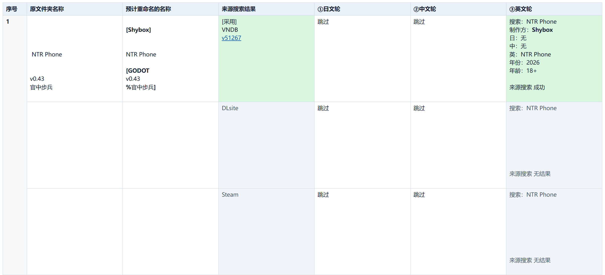
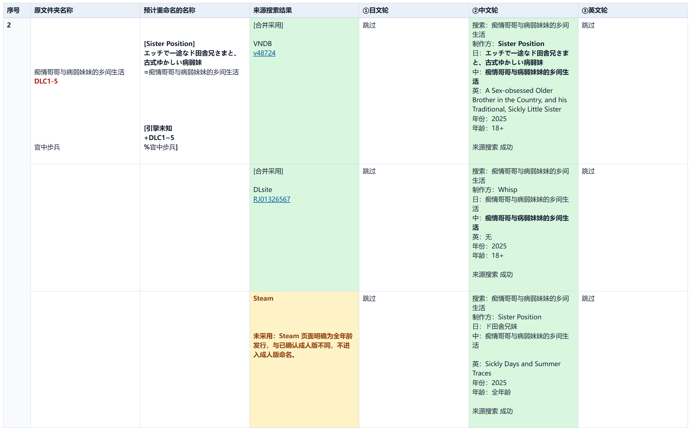
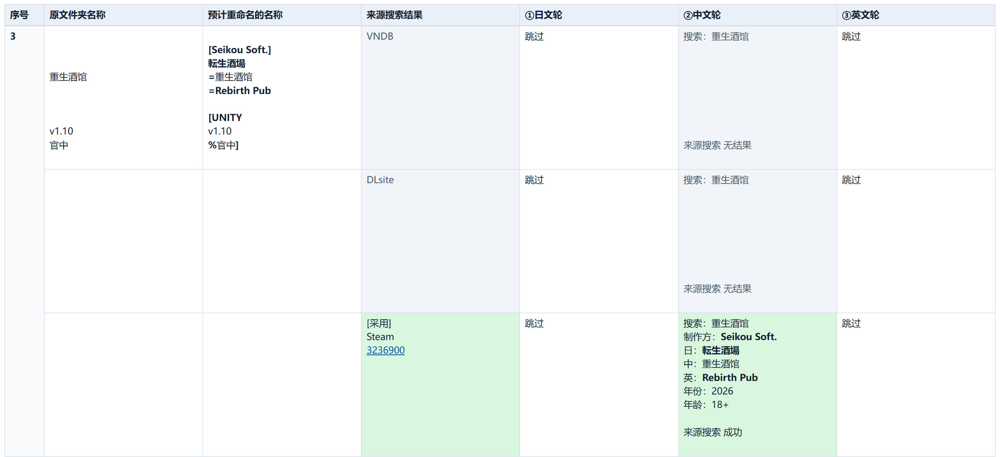

# VNDB/DLsite/Steam 游戏文件夹名称规范 Skill

[简体中文](README.md) | [English](README_EN.md)

游戏文件夹只有部分标题、缺少制作方，版本和标签写法也不统一时，逐个查资料并手动改名很费时。`renaming-game-folders` Skill 可批量核对 VNDB、DLsite、Steam，补全可信的制作方与日中英标题，整理本地版本、DLC 和标签，先预览再按批准执行。

## 最终效果预览

以下三个原名用于模拟重命名前目录；右列来自 Skill 的正式预览，尚未执行改名：

| 原文件夹名称 | 整理后的名称 |
|---|---|
| ` NTR Phone v0.43 官中步兵` | `[Shybox] NTR Phone [GODOT v0.43 %官中步兵]` |
| `痴情哥哥与病弱妹妹的乡间生活 DLC1-5 官中步兵` | `[Sister Position] エッチで一途なド田舎兄さまと、古式ゆかしい病弱妹 =痴情哥哥与病弱妹妹的乡间生活 [引擎未知 +DLC1~5 %官中步兵]` |
| `重生酒馆 v1.10 官中` | `[Seikou Soft.] 転生酒場 =重生酒馆 =Rebirth Pub [UNITY v1.10 %官中]` |

第二项因 100 字符名称上限去掉英文标题；原有 DLC 范围和标签保留。

以下是同一份 Skill HTML 预览的三段截图，点击可查看 [完整七列表格](docs/images/three-folder-skill-preview.png)。

Skill 只采用经审核的同作资料，不猜缺失的译名；本地标签保留原有语义，但写法会规范化。正式 `preview.html` 展示名称、来源与查询证据；预览不改目录，执行需要本次批准码。

## 如何配置

1. 安装 Python 3.11+；无需第三方 Python 包。
2. 复制项目并加载 [renaming-game-folders Skill](.agents/skills/renaming-game-folders/SKILL.md)。
3. 准备游戏目录；联网前授权向 VNDB、DLsite、Steam 发送本轮标题、查询词和来源 ID。大型目录可用 `--include-path` 限定子树。

## 如何使用

调用 Skill 并提供扫描根，例如：“使用 `renaming-game-folders` 预览 `D:\Games` 下的游戏文件夹改名”。

检查 `preview.html`、`decisions.md` 和 `folder-structure-preview/`；确认后提供本次批准码执行。目录或结果变化后须重新预览并批准。
