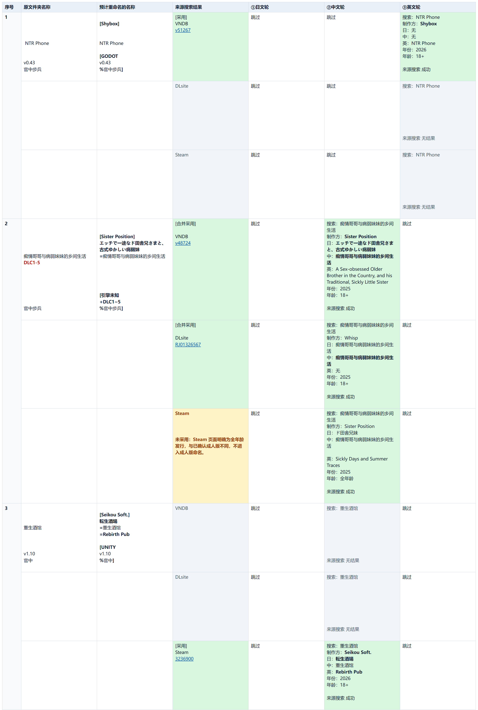

# VNDB/DLsite/Steam Game Folder Naming Skill

[简体中文](README.md) | [English](README_EN.md)

When game folders have partial titles, missing developers, or inconsistent version and tag notation, looking up each game and renaming it by hand takes time. The `renaming-game-folders` Skill reviews folders in batches against VNDB, DLsite, and Steam, fills confirmed developers and Japanese, Chinese, and English titles, organizes local versions, DLC, and tags, and previews changes before applying them with approval.

## Final result preview

These are real before-and-after names, with local paths omitted:

| Original folder name | Organized name |
|---|---|
| `重生酒馆 Rebirth Pub V1.10 官中` | `[Seikou Soft.] 転生酒場 =重生酒馆 =Rebirth Pub [UNITY v1.10 %官中]` |
| `NTR手机  NTR Phone v0.43 官中步兵` | `[Shybox] NTR Phone [GODOT v0.43 %官中步兵]` |
| `痴情哥哥与病弱妹妹的乡间生活 DLC1-5  steam 版 官中步兵` | `[Sister Position] エッチで一途なド田舎兄さまと、古式ゆかしい病弱妹 =痴情哥哥与病弱妹妹的乡间生活 =A Sex-obsessed Older Brother in the Country, and his Traditional, Sickly Little Sister [引擎未知 +DLC1~5 %官中步兵]` |

This is the Skill's actual HTML preview when the three organized names above are scanned together. The first two stay unchanged; the third loses its English title under the 100-character name limit.

The Skill uses reviewed matches and does not guess missing translations. Local tag meanings stay intact while their notation is normalized. The generated `preview.html` shows names, sources, and search evidence. Previewing changes no folders; applying requires that preview's approval code.

## Setup

1. Install Python 3.11+; no third-party Python packages are needed.
2. Copy the project and load the [renaming-game-folders Skill](.agents/skills/renaming-game-folders/SKILL.md).
3. Prepare the game directory. Before searching, authorize sending this run's titles, queries, and source IDs to VNDB, DLsite, and Steam. Use `--include-path` to limit large roots to selected subtrees.

## Usage

Invoke the Skill with a scan root, for example: “Use `renaming-game-folders` to preview renaming the game folders under `D:\Games`.”

Review `preview.html`, `decisions.md`, and `folder-structure-preview/`; then provide this preview's approval code to apply. Folder or result changes require a new preview and approval.
